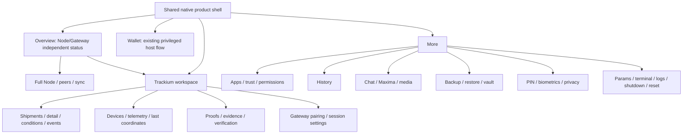

# Unified navigation — proposal, not implementation

## Текущее поведение

Host `MainActivity/MainAdapter` — ViewPager с Wallet, History, Apps, условным Chat и Node; по prototype изменению initially выбирается Node. History — native library, Chat зависит от Keets. Toolbar overflow открывает Params, app-lock, Backup, Terminal, Logs, battery/language/screenshot settings, shutdown/reset. Open Trackium — explicit private Activity того же APK.

Native Trackium имеет собственный bottom row Dashboard/Shipments/Devices/Proofs/Settings. Android Back завершает Activity и возвращает к host, а не попадает в web history; отдельного переопределения Back в текущем MainActivity.kt нет. Текущий tab сохраняется в onSaveInstanceState, но при новом запуске после finish снова Dashboard. «Return to node settings» делает finish() и не гарантирует Params. Activity onPause закрывает adapter и обнуляет listener; host node foreground service живёт отдельно. Locked entry не должен показывать cache. Forced FLAG_SECURE сохраняется даже при общем screenshot opt-in.

Web: hash navigation семь страниц, desktop sidebar/mobile drawer, detail dialog и Escape/focus. Browser Back, вкладки и refresh — браузерный контракт, не Android task stack. Authenticated server route renders отличаются от preview; нельзя превратить browser into privileged node UI или MDS MiniDapp посредством общей навигации.

## Предлагаемая информационная архитектура

Первый вариант на review: **Overview / Trackium / Wallet / More**. Node summary на Overview с переходом в полный Node screen; Node доступен и через More. Native phone root bar максимум4 постоянных destinations, без двух одновременных bottom bars. Второй допустимый вариант — отдельный Node root вместо Overview; владелец выбирает после task testing, не считать первый вариант утверждённым.

Ни один существующий capability не удаляется. More — группировка для discovery, а не повод спрятать обязательные security confirmations. Restore/backup/seed находятся в явной privileged области, не как обычная logistics card. Trackium sub-navigation — top tabs/segmented navigation или списки внутри workspace, не второй root bottom bar. Web сохраняет широкую sidebar и свои Map/Events destinations; на телефоне drawer/rail и domain navigation соответствуют общим названиям, но не имитируют Android task stack.

## Route contracts и Back

| Переход | Предлагаемый результат | Acceptance |
|---|---|---|
| Node → Open Trackium | Private native Activity; общий app bar/colour tokens/название, подсказка секции, тот же APK | Сохранены exact host ID, read-only adapter и secure window; никакого второго APK/browser |
| Trackium list → detail | Сохранить search/filter/scroll; понятный Up и системный Back | Back восстанавливает родительский список без потери draft/scroll |
| Trackium → host via Back | Вернуться в предыдущий host route/tab, не новый Wallet и не дублированный task | Single host instance, правильный selected destination, adapter closed onPause |
| Trackium Settings → Node settings | Реальный explicit route в Params **или** честный label «Return to node» | Текст и destination совпадают, не изменены параметры ноды автоматически |
| External share/permission dialog | При возврате восстановить route/UI state, re-observe, не повторить действие | No automatic submit, no stale response after background |
| Process death | Восстановить допустимый UI route/drafts; credentials remain SecureStore, node restarts through existing host lifecycle | Не сериализовать tokens, seed, private keys в Bundle или route string |
| Lock/relock | Secure placeholder/host unlock до любых cached tenant данных | Cold start, wrong PIN/cancel, expiry after background; lock не останавливает node по умолчанию |
| Deep link | Только явные разрешённые UI routes после lock/auth checks | Нельзя превратить private Activity в exported provisioning/command endpoint |
| Web hash Back | Вернуть page/filter/modal focus по web contract | Не смешивать Minima UID, cookie, native token или Android privilege |

В предложенной реализации понадобится небольшой shared navigation chrome/coordinator + typed route/state contracts. **Это ещё не архитектурное решение для массовой замены Activity.** Сначала внедряются токены/route labels; затем один согласованный navigation PR сохраняет прежние lifecycle observers, service binding, AppLock и direct transport guards. Не переводить native UI в WebView/remote JS и не давать shared nav privileged Command capability.

## Insets и state ownership

Host уже имеет SystemBars/KeyboardInsets; native Trackium задаёт fixed navy status/navigation bars и свой OnApplyWindowInsetsListener. Новый visual chrome обязан учитывать API28 и target35 edge-to-edge, IME, gesture/three-button navigation, cutout/landscape/multi-window. Нельзя одновременно двойным padding обработать consumed insets. Проверять Android Back/predictive Back отдельно; новый onboarding не должен неожиданно открывать node/кошелёк за lock.

UI state (route, selection, scroll, unsaved public origin/tenant fields) — state holder/SavedState с privacy classification. Domain cache/auth/paired session — текущий SecureStore/Gateway client. Node lifecycle — прежний service. Ни цветовая тема, ни navigation event не меняют key mode, key-use index, signing policy, network params или publisher state.

## Минимальная проверка согласования

Выбрать 2–3 задачи: «посмотреть последний sample груза», «понять почему node не синхронизирован», «восстановить прерванный pairing». Дать участникам текущие screenshots/макет без подсказки разработчика. Зафиксировать ошибочные переходы и понимание source/chain trust; затем утвердить IA. Для финансовых/seed сценариев никакие реальные деньги/ключи не нужны; тестировать comprehension и сохранность предупреждений отдельно.
